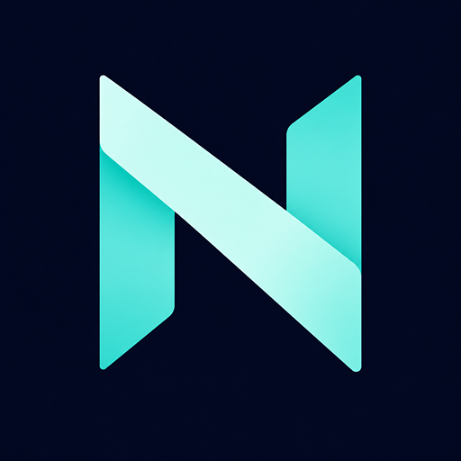

<p align="center">
  
</p>

<h1 align="center">NorthLight</h1>

<p align="center">
  <strong>The Ultimate Cinematic Movie Streaming Experience for Android TV & Google TV</strong>
</p>

<p align="center">
  <a href="https://github.com/aravindr31/northlight/releases/latest">
    
  </a>
  
  <a href="https://github.com/aravindr31/northlight/actions/workflows/ci.yml">
    
  </a>
  <a href="LICENSE">
    
  </a>
</p>

<p align="center">
  <a href="https://github.com/aravindr31/northlight/releases/latest">
    
  </a>
</p>

---

## 🌌 Overview

**NorthLight** is a native, modern Android TV application built from the ground up for the 10-foot living room experience. Combining sleek Jetpack Compose for TV interfaces with an embedded sequential streaming engine, NorthLight lets you discover trending cinema, browse enriched metadata from TMDB, and start streaming movies in seconds — without waiting for files to finish downloading.

Designed specifically for TV remote controls (D-pads), NorthLight delivers the fluid browsing experience of top streaming platforms alongside the freedom of open-source streaming.

---

## ✨ Features

### 📺 Living Room Native (Jetpack Compose for TV)
- **10-Foot UI Experience**: Engineered specifically for TV screens and directional remotes with smooth focus transitions and responsive animations.
- **Cinematic Backdrop Displays**: Full-screen, high-resolution backdrops dynamically update as you browse titles.
- **Category Filter Chips**: Effortlessly switch between genres — Action, Comedy, Sci-Fi, Drama, Horror, Romance, Documentaries, and more.
- **Quality Badges**: Clearly view available video resolutions (720p, 1080p, 2160p 4K) with file sizes and seeder health.

### ⚡ Instant Sequential P2P Streaming
- **Built-in Torrent Engine**: Powered by `libtorrent4j`, NorthLight downloads torrent pieces sequentially from start to finish.
- **Local Embedded HTTP Server**: Streams directly to the media player via an internal `NanoHTTPD` server running locally on the device (`http://127.0.0.1:<port>`).
- **Full Range-Request Seeking**: Jump to any timestamp in the video just like a traditional streaming service once initial buffers are acquired.
- **No Setup or Accounts Needed**: Local streaming is completely free, built-in, and requires zero logins or third-party subscriptions.

### 🎬 Enriched TMDB Metadata
- **Automatic IMDB Code Mapping**: Connects public movie catalogues directly to TMDB v3 API.
- **Comprehensive Movie Details**: Taglines, detailed synopses, user ratings, MPAA age ratings, runtime, and release dates.
- **Director & Cast Profiles**: Scrollable cast rows displaying actor portraits, real names, and character roles.
- **Smart Suggestions**: Discover similar and recommended titles on every detail page.

### 🍿 Dual Playback Modes (ExoPlayer + VLC)
- **Built-in Google Media3 Player**: Seamless, native video playback with dedicated D-pad play, pause, seek, and audio controls.
- **1-Click "Open in VLC"**: Prefer an external video player? One click launches the stream into **VLC for Android TV** (`org.videolan.vlc`) with full support for hardware decoders, advanced audio pass-through, and custom subtitle tracks.
- **Smart App Detection**: Prompts a direct Google Play Store installation if VLC is not already installed on the TV.

### ☁️ Pluggable Cloud Debrid Providers
- Switch between streaming backends in Settings at any time:
  - **Local Torrent (Built-in)**: Zero cost, direct peer-to-peer.
  - **Real-Debrid**: High-speed, cached cloud streaming for premium subscribers.
  - **Seedr**: Lightweight cloud torrent fetching with a 2GB free tier.

### 🔍 Real-Time TV Search & Filtering
- Instant, debounced title search optimized for TV on-screen keyboards and voice remotes.
- Sort movies by **Latest Added**, **Highest Rating**, **Most Seeders**, or **Release Year**.

---

## 📲 How to Install (Sideloading Guide)

NorthLight is packaged and released as a standalone Android TV APK. You can install it on any Android TV, Google TV, Nvidia Shield, or Amazon Fire TV device using any of the following methods:

### Method 1: Using the Downloader App (Recommended for TV)
1. Install the **Downloader** app from the Google Play Store or Amazon Appstore on your TV.
2. In your TV's settings, enable **Install Unknown Apps** for the Downloader app.
3. Open Downloader and enter the direct APK URL from our [Latest Releases](https://github.com/aravindr31/northlight/releases/latest):
   ```text
   https://github.com/aravindr31/northlight/releases/latest/download/NorthLight-v1.0.0.apk
   ```
4. Click **Download** and select **Install** when prompted.

### Method 2: Sideloading via ADB (Wireless or USB)
If you have ADB debugging enabled on your TV:
```bash
# Connect to your Android TV over Wi-Fi
adb connect <YOUR_TV_IP_ADDRESS>:5555

# Install the downloaded release APK
adb install NorthLight-v1.0.0.apk
```

### Method 3: USB Flash Drive
1. Download `NorthLight-v1.0.0.apk` on your computer from the [Releases page](https://github.com/aravindr31/northlight/releases).
2. Copy the `.apk` file to a USB flash drive.
3. Plug the USB drive into your TV, open any TV file manager app (e.g., *File Commander* or *FX File Explorer*), navigate to the APK, and install it.

---

## 📺 Supported Devices & System Requirements

| Specification | Requirement |
| :--- | :--- |
| **Operating System** | Android 6.0 Marshmallow (API 23) or higher |
| **Target Platform** | Android TV, Google TV, Fire TV (Fire OS 6+) |
| **Architectures** | `arm64-v8a`, `armeabi-v7a` |
| **Tested Devices** | Chromecast with Google TV (4K & HD), Nvidia Shield TV / Pro, Xiaomi Mi Box / TV Stick, Sony Bravia Google TV, Amazon Fire TV Stick 4K |
| **Network** | Stable broadband connection (15+ Mbps recommended for 1080p/4K streaming) |

---

## 🛠️ Configuration (Optional)

NorthLight runs out of the box with zero required configuration. To customize your installation:

* **TMDB API Key (Optional)**: If you would like to use your own personal TMDB API v3 key to bypass public rate limits:
  1. Create a `local.properties` file in the project root:
     ```properties
     TMDB_API_KEY=your_tmdb_api_key_here
     ```
  2. For CI/CD builds, configure the `TMDB_API_KEY` repository secret in GitHub.
* **Streaming Backend**: Head to the **Settings** screen inside the app to select your preferred streaming backend (Local Torrent, Real-Debrid, or Seedr).

---

## 🏗️ Architecture & Tech Stack

NorthLight is engineered following modern Android architecture best practices with a clean multi-module setup:

- **UI & Presentation**: Jetpack Compose for TV (`androidx.tv:tv-material`, `androidx.tv:tv-foundation`), Compose Navigation, Material3.
- **Dependency Injection**: Dagger Hilt with KSP (Kotlin Symbol Processing).
- **Networking**: Retrofit 2, OkHttp 4 with HTTP logging, Moshi JSON serialization.
- **Asynchronous Flow**: Kotlin Coroutines & StateFlow.
- **Image Loading**: Coil 2 with custom disk caching and memory management.
- **Media Engine**: Google Media3 ExoPlayer + `NanoHTTPD` lightweight embedded web server.
- **Torrent Engine**: `libtorrent4j` (libtorrent v2 C++ core with JNI bindings for ARM64/ARMv7).
- **Local Persistence**: Jetpack Room Database & Jetpack DataStore Preferences.
- **CI/CD Automation**: GitHub Actions with automated SemVer calculation, CodeQL security scanning, and automated release deployment.

---

## 📄 License

This project is licensed under the **MIT License** — see the [LICENSE](LICENSE) file for details.

---

## ⚖️ Legal Disclaimer

NorthLight is an open-source media player and aggregator application created strictly for educational and personal media consumption purposes. NorthLight does not host, store, index, or distribute any media files, video streams, or copyright-protected content. All metadata and cover images are provided via public API services (YTS public API and TMDB API). Users are solely responsible for ensuring their usage complies with all local laws and copyright regulations in their jurisdiction.
